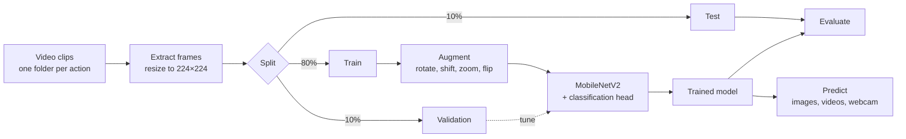
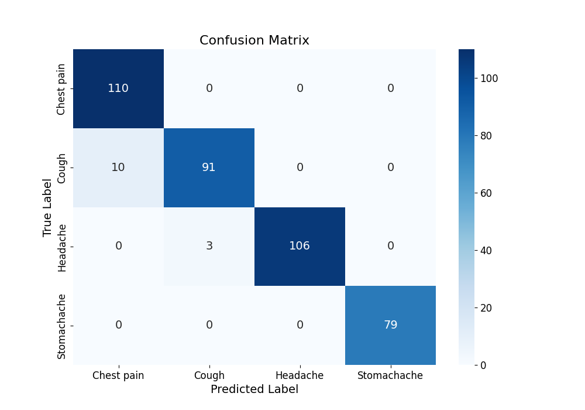
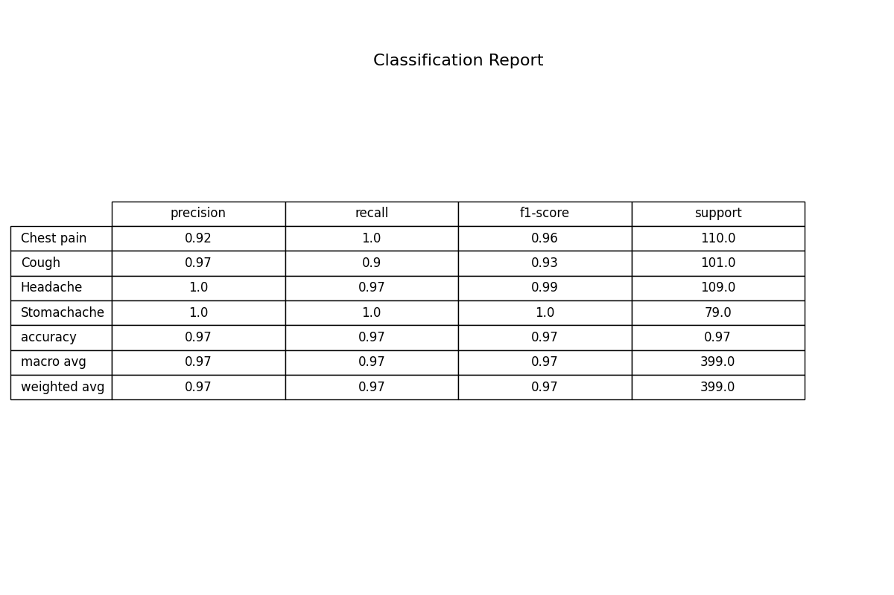
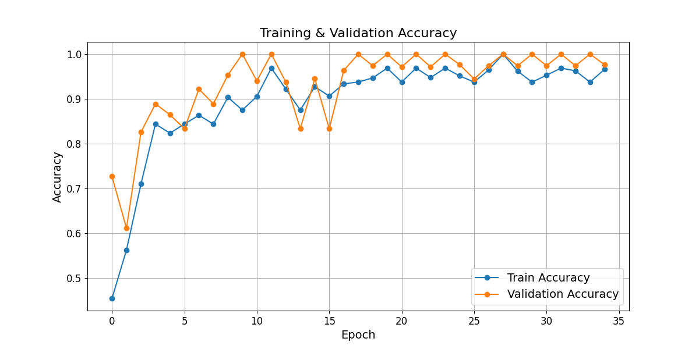
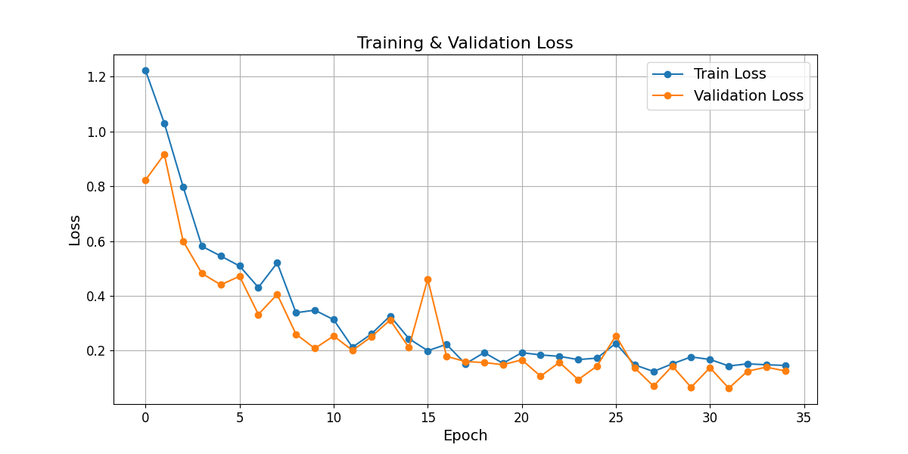

# Abnormal Human Action Recognition with MobileNetV2

This is the code behind our paper *Abnormal Human Action Recognition Using MobileNetV2 with Advanced Data Augmentation and Fine-Tuning Techniques*, presented at ARIIA 2024 in Manipal ([DOI: 10.1109/ARIIA63345.2024.11051456](https://doi.org/10.1109/ARIIA63345.2024.11051456)).

The idea started during my internship in 2022: could a small, cheap model watch a patient on camera and notice when something looks wrong? We picked four actions that usually mean someone is in discomfort (chest pain, coughing, headache and stomachache) and trained MobileNetV2 to tell them apart from single video frames. MobileNetV2 was the obvious choice because it's light enough to run on embedded hardware, which is where something like this would actually live.

## How it works

We recorded short clips of each action, cut them into frames, resized everything to 224×224 and split the frames 80/10/10 into train, validation and test sets.



The model is MobileNetV2 pre-trained on ImageNet, with a small head on top: global average pooling, a 128-unit dense layer, dropout of 0.5 and a 4-way softmax. Training happens in two rounds. First only the head is trained for 35 epochs with the backbone frozen (Adam, learning rate 1e-4). Then the last 50 layers of MobileNetV2 are unfrozen and the whole thing is fine-tuned for another 17 epochs at a ten times smaller learning rate. During training, frames get randomly rotated, shifted, zoomed and flipped, which helped a lot with such a small dataset.

## Results

The model reached 97% accuracy on the test frames.

| Confusion matrix | Per-class scores |
|---|---|
|  |  |

| Accuracy during training | Loss during training |
|---|---|
|  |  |

The ROC and precision-recall curves are in [results/paper](results/paper/).

A caveat I want to be upfront about: these numbers come from splitting individual frames at random. Frames next to each other in a video are almost identical, so the test set ends up very similar to what the model trained on. The 97% therefore tells you how well the model handles clips it has already seen, not new people or new rooms. That's why `split_dataset.py` now splits by whole video by default, which gives a more realistic number. You can still pass `--by frame` to reproduce the paper.

## Running it

You'll need Python 3.10 or newer.

```bash
python -m venv .venv
source .venv/bin/activate
pip install -r requirements.txt
```

The videos we recorded aren't included because they show real people. To train on your own, put your clips in one folder per action:

```
data/videos/
  chest_pain/
  cough/
  headache/
  stomachache/
```

Then run the steps in order:

```bash
python src/extract_frames.py     # videos -> frames
python src/split_dataset.py      # frames -> train/val/test (add --by frame to match the paper)
python src/train.py              # saves models/model.keras
python src/evaluate.py           # plots and metrics go to results/latest/
```

To try the trained model:

```bash
python src/predict.py some_image.jpg some_clip.mp4   # annotated copies go to predictions/
python src/predict.py --webcam                       # live, press q to quit
```

With a video or the webcam, it averages the last 10 predictions so the label doesn't flicker. Add `--gif` if you want an animated GIF of the result.

All the paths and training settings live in [config.py](config.py).

## What I'd do next

The biggest problem is data. More people, more rooms and more lighting conditions would probably help more than any change to the model. It would also be worth trying pose-based approaches (MediaPipe, for example), since they look at body movement rather than pixels and shouldn't care what the background looks like. And since we're classifying one frame at a time, a model that looks at short sequences could tell a cough from a hand resting on the chest much more reliably.

## Citation

If this is useful for your work, please cite the paper:

```bibtex
@inproceedings{sundesha2024abnormal,
  title     = {Abnormal Human Action Recognition Using MobileNetV2 with Advanced Data Augmentation and Fine-Tuning Techniques},
  author    = {Sundesha, Tanu and Shrivas, Nikhil Vivek and Shanvi},
  booktitle = {2024 International Conference on Augmented Reality, Intelligent Systems, and Industrial Automation (ARIIA)},
  pages     = {1--6},
  year      = {2024},
  publisher = {IEEE},
  doi       = {10.1109/ARIIA63345.2024.11051456}
}
```
